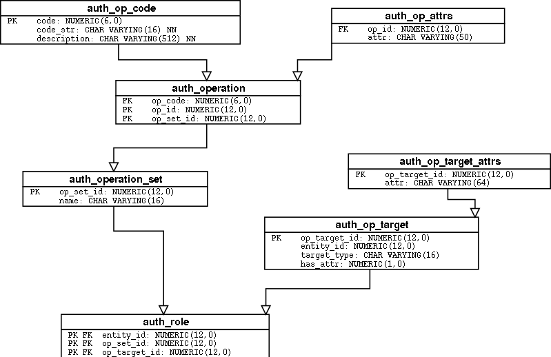

===================
bofhd authorization
===================

.. admonition:: Needs review

   This is an old, and slightly unstructured document.

   It should probably be split into separate documents, and structured a bit
   better.

.. contents:: Contents

Authorization
=============
Base authorization in bofhd is handled by the module
``Cerebrum.modules.bofhd.auth``.  The class ``BofhdAuth`` defines a
number of ``can_*`` methods that must be called by their respective commands in
their command implementation.  The methods returns True on success, and throws a
``PermissionDenied`` error on failure.

Most ``can_*``-methods support an optional ``query_run_any``-method.  When this
is set to true, the method should only return ``True`` or ``False`` to indicate
whether a given user should *see* the related commands in their clients.

Different command classes will use different ``BofhdAuth`` subclasses for
authorization.  Some institutions will have their own "global" authorization
classes. In these cases, the institution will also need:

1. A separate BofhdFooAuth-subclass, with the proper global auth class mixed in.
2. A separate BofhdFooCommand-subclass, with ``authz`` set to the custom
   BofhdFooAuth-class

BofhdAuth data model
--------------------
To answer the various ``can_*`` questions, the auth module defines a
datamodel shown in fig_auth_.

The various operations that can be performed, such as ``set_password``,
``create_user`` etc. are stored in ``auth_operation``.  Since it is common
to grant permission to more than one operation at a time,
auth_operations are grouped into an ``auth_operation_set``.

``auth_op_target`` stores the targets that an operation may be
performed on.  A target has a ``target_type`` that may be one of host,
disk, group, global_host or global_group.  For a host
``auth_op_target_attrs`` may contain a regexp indicating which disks
on the host the target actually covers.  global_host/global_group will
not affect BOFHD_SUPERUSER_GROUP or its members.

``auth_role`` maps an ``auth_operation_set`` to an ``auth_op_target``
for a given entity_id.  The current implementation of ``BofhdAuth``
allows entity_id to point to an account or a group.

Modification of the above mentioned tables are done by a number of
helper classes.  Please see their class documentation for details.

- ``BofhdAuthOpSet``
- ``BofhdAuthOpTarget``
- ``BofhdAuthRole``

.. _fig_auth :

Figure: Diagram of the databaseschema for authorization

